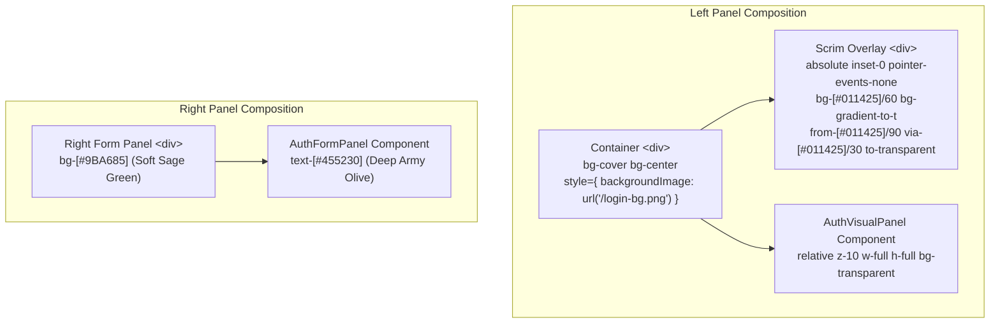

# Left Panel Custom Background Image Implementation Plan

> **For agentic workers:** REQUIRED SUB-SKILL: Use superpowers:subagent-driven-development to implement this plan task-by-task. Steps use checkbox (`- [ ]`) syntax for tracking.

**Goal:** Update the left visual panel in `src/pages/LoginPage.jsx` to support and render a high-resolution, moody dark sage-green and olive minimalist landscape background image (`public/login-bg.png`) with an ambient gradient scrim overlay (`#011425`) for enhanced contrast, depth, and typography protection.

**Architecture:**
- Create `frontend/public/` directory and populate it with `login-bg.png` sourced from the user's high-resolution moody green landscape photograph.
- Update `src/pages/LoginPage.jsx` left column container `<div>` to:
  - Have classes: `lg:col-span-6 order-1 lg:order-1 relative flex flex-col min-h-[440px] lg:min-h-[820px] bg-cover bg-center overflow-hidden`
  - Inline style: `backgroundImage: "url('/login-bg.png')"`
  - Overlay child: `<div className="absolute inset-0 bg-[#011425]/60 bg-gradient-to-t from-[#011425]/90 via-[#011425]/30 to-transparent pointer-events-none" />`
- Update `src/components/auth/AuthVisualPanel.jsx` to be a transparent relative container (`relative z-10 w-full h-full min-h-[440px] lg:min-h-[820px] flex flex-col justify-between p-8 sm:p-12`), ensuring zero background occlusion over the image and scrim.
- Keep the borderless layout and the Soft Sage (`#9BA685`) "Create an account" form panel intact.

**Architecture Diagram:**



**Tech Stack:**
- Vite 5 + React 18
- Tailwind CSS 3
- Asset pipeline: `public/login-bg.png`

---

## Global Constraints

- **Image Path Integrity:** The background image must be located at `public/login-bg.png` so Vite serves it statically at `/login-bg.png` in both dev and production builds.
- **Scrim Layer Accuracy:** Exact scrim class string requested: `absolute inset-0 bg-[#011425]/60 bg-gradient-to-t from-[#011425]/90 via-[#011425]/30 to-transparent pointer-events-none`.
- **Resource Constraints:** Keep engine memory strictly under 250 MB RAM using 4 KB chunk discards.
- **Git Safety Rule:** AI assistant is strictly prohibited from executing `git commit`, `git merge`, `git rebase`, or `git push`.
- **Review Gate:** Zero code modifications will be executed until the user explicitly reviews and approves this plan.

---

## Proposed Changes

### Component 1: Static Asset Directory (`frontend/public/`)
#### [NEW] `frontend/public/login-bg.png`
- Deploy the high-resolution, moody dark sage-green and olive minimalist landscape photograph into `frontend/public/login-bg.png`.

---

### Component 2: Left Panel Container in `src/pages/LoginPage.jsx`
#### [MODIFY] `frontend/src/pages/LoginPage.jsx`
- Replace solid color wrapper `div` on the left column with:
```jsx
{/* Left Column: Background Image with Gradient Scrim */}
<div
  className="lg:col-span-6 order-1 lg:order-1 relative flex flex-col min-h-[440px] lg:min-h-[820px] bg-cover bg-center overflow-hidden"
  style={{ backgroundImage: "url('/login-bg.png')" }}
>
  {/* Dark gradient scrim overlay */}
  <div className="absolute inset-0 bg-[#011425]/60 bg-gradient-to-t from-[#011425]/90 via-[#011425]/30 to-transparent pointer-events-none" />
  <AuthVisualPanel />
</div>
```

---

### Component 3: Clean Transparent Visual Panel (`AuthVisualPanel.jsx`)
#### [MODIFY] `frontend/src/components/auth/AuthVisualPanel.jsx`
- Remove solid `bg-[#637545]` so the panel is transparent and allows the background image and scrim to show through seamlessly:
```jsx
import React from 'react';

export default function AuthVisualPanel() {
  return (
    <div className="relative z-10 w-full h-full min-h-[440px] lg:min-h-[820px] bg-transparent" />
  );
}
```

---

## Task Structure

### Task 1: Asset Placement
- [x] Create `frontend/public/` folder.
- [x] Copy the user-uploaded moody landscape image (`media_1794846020235_9c7baf23.jpg`) to `frontend/public/login-bg.png`.

### Task 2: Update `LoginPage.jsx` & `AuthVisualPanel.jsx`
- [x] Configure `style={{ backgroundImage: "url('/login-bg.png')" }}` and `bg-cover bg-center` on the left panel container.
- [x] Add the exact dark gradient scrim overlay inside the left container.
- [x] Set `AuthVisualPanel` to `bg-transparent relative z-10`.

### Task 3: Build Verification & Documentation
- [x] Run `cd frontend; npm run build` and ensure exit code 0.
- [x] Update `walkthrough.md` with visual evidence and verification.
