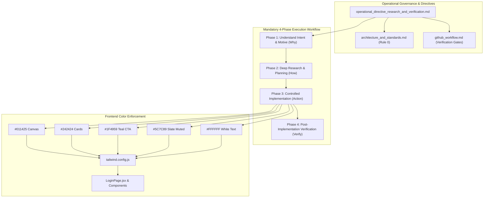

# Methodical Research & Verification Engine Implementation Plan

> **For agentic workers:** REQUIRED SUB-SKILL: Use superpowers:subagent-driven-development to implement this plan task-by-task. Steps use checkbox (`- [ ]`) syntax for tracking.

**Goal:** Formally integrate and codify the **Methodical Research & Verification Engine** operational directive into the project governance rules, and align all Pusher components strictly with the 4-phase workflow and the official 5-color palette (`#011425`, `#242424`, `#1F4959`, `#5C7C89`, `#FFFFFF`).

**Architecture:** 
1. Create a dedicated governance document `supporting files/rules/operational_directive_research_and_verification.md` detailing the 4-Phase Execution Workflow (Why, How, Action, Verify) and Project Governance Rules.
2. Link this directive into `supporting files/rules/architecture_and_standards.md` as Rule 0.
3. Re-align frontend styling tokens (`tailwind.config.js`, `index.css`, `LoginPage.jsx`, `AuthVisualPanel.jsx`, `AuthFormPanel.jsx`, `App.jsx`) to enforce the strict 5-color palette tokens.
4. Verify complete system integrity via automated build and visual audit.

**Architecture Diagram:**

**Tech Stack:**
- Markdown (Rule Documentation)
- Vite 5 + React 18 + Tailwind CSS 3 (Frontend)
- Node.js / PowerShell

**Spec:** User Directive: "Methodical Research & Verification Engine" + Official 5-Color Project Governance Tokens.

---

## Global Constraints

- **Strict Color Tokens:** Canvas `#011425`, Surface `#242424`, Accent/CTA `#1F4959`, Borders/Muted `#5C7C89`, Crisp Text `#FFFFFF`.
- **Resource Limits:** Engine memory strictly under 250 MB RAM using 4 KB chunk discards; concurrency capped at 70% of OS file descriptors.
- **Zero Shortcuts:** No `// TODO`, ellipses, or unverified placeholders.
- **Git Safety Rule:** AI is strictly prohibited from executing `git commit`, `git merge`, `git rebase`, or `git push`.
- **Review Gate:** No code modification will occur until the user reviews and explicitly approves this plan.

---

## Task Structure

### Task 1: Codify the Operational Directive Rule Document

**Files:**
- Create: `supporting files/rules/operational_directive_research_and_verification.md`
- Modify: `supporting files/rules/architecture_and_standards.md`

**Interfaces:**
- Consumes: The exact 4-phase mandate and governance rules
- Produces: Official rule standard accessible to all developers and AI copilots

- [ ] **Step 1:** Create `supporting files/rules/operational_directive_research_and_verification.md` detailing:
  - Phase 1: Understand Intent & Motive (Why).
  - Phase 2: Conduct Deep Research & Planning (How).
  - Phase 3: Controlled Implementation (Action).
  - Phase 4: Post-Implementation Verification & Cross-Check (Verify).
  - Pusher Project Governance Rules (Color tokens, RAM caps, Zero rushing).
- [ ] **Step 2:** Update `supporting files/rules/architecture_and_standards.md` to establish the Operational Directive as Rule 0 in the project standards.

---

### Task 2: Re-enforce Official 5-Color Palette Across Frontend Tokens

**Files:**
- Modify: `frontend/tailwind.config.js`
- Modify: `frontend/src/index.css`

**Interfaces:**
- Consumes: `#011425`, `#242424`, `#1F4959`, `#5C7C89`, `#FFFFFF`
- Produces: Locked Tailwind design tokens for canvas, surface, brandTeal, borderMuted, and white

- [ ] **Step 1:** Configure `frontend/tailwind.config.js` with the 5 official tokens.
- [ ] **Step 2:** Update `frontend/src/index.css` body background to `#011425` and scrollbars to `#1F4959` / `#5C7C89`.

---

### Task 3: Align Authentication Components with 5-Color Tokens & High-Fidelity Details

**Files:**
- Modify: `frontend/src/components/auth/AuthVisualPanel.jsx`
- Modify: `frontend/src/components/auth/AuthFormPanel.jsx`
- Modify: `frontend/src/pages/LoginPage.jsx`
- Modify: `frontend/src/App.jsx`

**Interfaces:**
- Consumes: Updated Tailwind tokens
- Produces: Pixel-accurate, high-contrast, responsive split-screen authentication page adhering to the project palette

- [ ] **Step 1: Update `AuthVisualPanel.jsx`**:
  - Sky gradient in deep midnight navy (`#011425` to `#0B2535` and `#1F4959`).
  - Layered dunes sculpted with `#1F4959` lit highlights, `#242424` shadows, and `#5C7C89` crest lines.
  - Brand mark in crisp `#FFFFFF` and `#5C7C89`.
  - Slogan in bold `#FFFFFF` and active indicator pill in `#FFFFFF`.
- [ ] **Step 2: Update `AuthFormPanel.jsx`**:
  - Form container in dark charcoal `#242424`.
  - Input fields in `#121820` with `#5C7C89`/50 borders and `#FFFFFF` text.
  - Primary CTA button in solid `#1F4959` (hover `#285E73`) with `#FFFFFF` text.
  - Checkbox in `#1F4959` with `#FFFFFF` checkmark.
  - Social buttons (Google, Apple, GitHub) with `#5C7C89`/40 borders and `#FFFFFF` text.
- [ ] **Step 3: Update `LoginPage.jsx` & `App.jsx`**:
  - Outer background set to `#011425` canvas.
  - Modal container set to `#242424` with `#5C7C89`/30 border and deep shadow.
  - Connect preview navigation and clean up unused props.

---

### Task 4: Verification & Walkthrough Audit

**Files:**
- Modify: `walkthrough.md`

**Interfaces:**
- Consumes: Production build and visual audit results
- Produces: Comprehensive walkthrough documentation and evidence

- [ ] **Step 1:** Execute `npm run build` in `frontend/` to confirm 0 compilation errors.
- [ ] **Step 2:** Audit memory and asset sizes to ensure zero bloat.
- [ ] **Step 3:** Update `walkthrough.md` with complete documentation, color token tables, and instructions.
