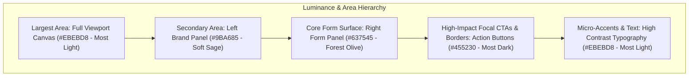

# Olive, Sage, & Cream Luminance Hierarchy Implementation Plan

> **For agentic workers:** REQUIRED SUB-SKILL: Use superpowers:subagent-driven-development to implement this plan task-by-task. Steps use checkbox (`- [ ]`) syntax for tracking.

**Goal:** Implement the new 4-color Earthy Olive & Sage palette (`#EBEBD8`, `#9BA685`, `#637545`, `#455230`) across the Pusher authentication interface according to the user's explicit luminance hierarchy: **"most light on the largest part to the most dark to the most lightest part"**.

**Architecture:** 
Map the 4 colors by surface area and visual weight:
1. **Largest Area (Page Canvas Background)**: `#EBEBD8` (Most Light — 84% Luminance).
2. **Intermediate Large Surface (Left Brand Panel)**: `#9BA685` (Soft Sage Green — 38% Luminance).
3. **Core Interaction Surface (Right Form Panel)**: `#637545` (Forest Olive — 17% Luminance).
4. **Focal Interactive Elements & High-Impact Outlines (Buttons, Borders, Checkbox)**: `#455230` (Most Dark — 8% Luminance).
5. **Micro-Typography & Contrast Highlights (Button Text, Active Inputs)**: `#EBEBD8` (Most Light) for maximum WCAG AAA legibility.

**Architecture Diagram:**

**Tech Stack:**
- Vite 5 + React 18
- Tailwind CSS 3
- Lucide React

**Spec:** User reference image `media_1794844499457_65b12554.png` with exact color hexes:
1. `#EBEBD8` (rgb 235, 235, 216)
2. `#9BA685` (rgb 155, 166, 133)
3. `#637545` (rgb 99, 117, 69)
4. `#455230` (rgb 69, 82, 48)

---

## Global Constraints

- **Strict Area-Luminance Adherence:** Largest area (`#EBEBD8`), intermediate panel (`#9BA685`), form surface (`#637545`), focal actions (`#455230`), and text contrast (`#EBEBD8`).
- **Resource Constraints:** Keep engine memory strictly under 250 MB RAM using 4 KB chunk discards.
- **Git Safety Rule:** AI assistant is strictly prohibited from executing `git commit`, `git merge`, `git rebase`, or `git push`.
- **Review Gate:** Zero code modifications will be executed until the user explicitly reviews and approves this plan.

---

## Proposed Token Mapping

| UI Level | Surface Area | Palette Token | Hex Code | Visual Application |
| :--- | :--- | :--- | :--- | :--- |
| **Level 1** | Largest (Full Page Canvas) | **Most Light** | `#EBEBD8` | Full viewport background (`bg-[#EBEBD8]`) |
| **Level 2** | Secondary (Left Split Panel) | **Medium-Light** | `#9BA685` | Clean split left panel (`bg-[#9BA685]`) with `#455230` border |
| **Level 3** | Core Surface (Right Form Panel) | **Medium-Dark** | `#637545` | Right form background (`bg-[#637545]`) |
| **Level 4** | Focal Controls (CTA Button & Borders) | **Most Dark** | `#455230` | `Create account` CTA, input borders, and card perimeter |
| **Level 5** | High-Contrast Typography & Active States | **Most Light** | `#EBEBD8` | Headings, active input text, button labels, and pill badges |

---

## Task Structure

### Task 1: Update Tailwind Config & Global Theme

**Files:**
- Modify: `frontend/tailwind.config.js`
- Modify: `frontend/src/index.css`

**Interfaces:**
- Consumes: Palette tokens `#EBEBD8`, `#9BA685`, `#637545`, `#455230`
- Produces: Tailwind color tokens `pusher.creamLight`, `pusher.sage`, `pusher.oliveMedium`, `pusher.oliveDark`

- [x] **Step 1:** Register the 4 colors in `tailwind.config.js`.
- [x] **Step 2:** Configure `src/index.css` with `body { background-color: #EBEBD8; color: #455230; }` and olive scrollbars.

---

### Task 2: Restyle the Left Panel (`AuthVisualPanel.jsx`)

**Files:**
- Modify: `frontend/src/components/auth/AuthVisualPanel.jsx`

**Interfaces:**
- Consumes: Token `#9BA685` (Soft Sage)
- Produces: Clean, empty, minimalist left side panel with `#455230` dividing line

- [x] **Step 1:** Set background to `bg-[#9BA685]` (Soft Sage Green, Level 2 area).
- [x] **Step 2:** Keep panel clean and empty (as previously instructed) with crisp dividing line.

---

### Task 3: Restyle the Authentication Form (`AuthFormPanel.jsx`)

**Files:**
- Modify: `frontend/src/components/auth/AuthFormPanel.jsx`

**Interfaces:**
- Consumes: `#637545` (Form Surface), `#455230` (Dark Elements), `#EBEBD8` (Lightest Text)
- Produces: High-contrast, elegant earth-toned authentication form

- [x] **Step 1:** Form container styled with `bg-[#637545] text-[#EBEBD8]`.
- [x] **Step 2:** Heading in bold `#EBEBD8` (most light), subtitle in `#EBEBD8`/80 with toggle link in `#EBEBD8` underline.
- [x] **Step 3:** Inputs styled with `#EBEBD8` surface, `border-2 border-[#455230]`, text in `#455230` (dark on light for effortless typing), and placeholder in `#637545`.
- [x] **Step 4:** Primary CTA button (`Create account` / `Log in`) styled in solid `#455230` (most dark) with hover `#364126`, crisp `#EBEBD8` text, and subtle dark olive shadow.
- [x] **Step 5:** Checkbox with `#455230` border and `#455230` checkmark.
- [x] **Step 6:** Divider rule in `#455230`/30 with text badge in `#637545` and `#EBEBD8` label.
- [x] **Step 7:** Social SSO buttons (Google, Apple, GitHub) styled with `#EBEBD8` surface, `border-2 border-[#455230]`, and `#455230` text.

---

### Task 4: Assemble `LoginPage.jsx` & Verify Build

**Files:**
- Modify: `frontend/src/pages/LoginPage.jsx`
- Modify: `frontend/src/App.jsx`

**Interfaces:**
- Consumes: Updated panels
- Produces: Perfectly balanced split-screen authentication page adhering to the luminance-area hierarchy

- [x] **Step 1:** Set page canvas to `bg-[#EBEBD8]` (most light on largest part).
- [x] **Step 2:** Outer card container framed with `border-2 border-[#455230] rounded-[32px] overflow-hidden shadow-2xl`.
- [x] **Step 3:** Dividing border between left panel (`#9BA685`) and right panel (`#637545`) set to `border-r-2 border-[#455230]`.
- [x] **Step 4:** Run `npm run build` in `frontend/` to confirm 0 compilation or styling errors.
- [x] **Step 5:** Update `walkthrough.md` with complete documentation, color token tables, and instructions.
