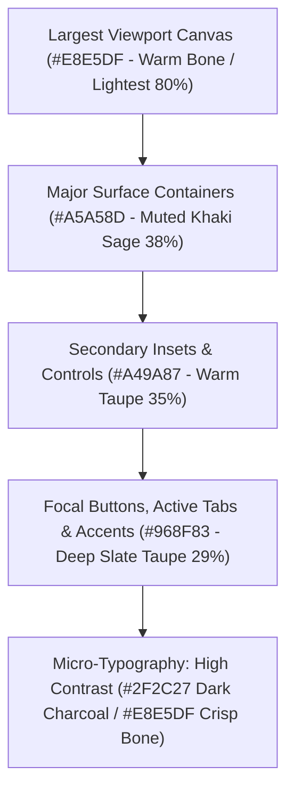

# 4-Color Earthy Taupe, Sage & Bone Palette Migration Plan

## 🎯 Goal Description
Migrate the Pusher frontend application (`src/pages/LoginPage.jsx`, `src/pages/DashboardPage.jsx`, and `src/App.jsx`) to the 4-color earth palette specified in user reference `media_1794899479924_76e613c8.png`:
- **`#A49A87`**: Warm Taupe / Earthy Gray
- **`#A5A58D`**: Muted Khaki Sage Green
- **`#968F83`**: Deep Slate Taupe (Darkest tone in palette)
- **`#E8E5DF`**: Soft Warm Bone / Off-White (Lightest tone in palette)

---

## 🎨 Luminance & Surface Area Architecture



### Token Mapping Table

| UI Layer | Surface / Component | Palette Token | Hex Code | Visual Application |
| :--- | :--- | :--- | :--- | :--- |
| **Level 1 (Lightest)** | Page Canvas / Outer Background | **Bone Off-White** | `#E8E5DF` | Viewport background (`bg-[#E8E5DF]`) for Login & Dashboard |
| **Level 2 (Medium)** | Outer Cards & Sidebar | **Khaki Sage** | `#A5A58D` | Split card container, Dashboard sidebar, Launcher card |
| **Level 3 (Medium-Dark)** | Inset Panels, Form Inputs, Tables | **Warm Taupe** | `#A49A87` | Form inputs (`bg-[#E8E5DF]` with `#A49A87` border), unselected pills |
| **Level 4 (Darkest)** | Focal Buttons & Active States | **Earth Slate Taupe** | `#968F83` | `Create account` button, `+ New Load Test`, active tabs |
| **Level 5 (Typography)** | High-Contrast Primary Text | **Charcoal Earth** | `#2F2C27` | Headings, labels, metric numbers on light surfaces |
| **Level 5 (Inverted)** | High-Contrast Action Text | **Crisp Bone** | `#E8E5DF` | Text inside `#968F83` buttons and active segmented controls |

---

## ⚠️ User Review Required

> [!IMPORTANT]
> This palette migration unifies both **`LoginPage.jsx`** and **`DashboardPage.jsx`** under the same cohesive 4-color palette from your uploaded image.
> - **Input Fields**: Lighter `#E8E5DF` with subtle `#A49A87` focus rings.
> - **Action Buttons**: Solid `#968F83` deep slate taupe with crisp `#E8E5DF` bone lettering.
> - **Sidebar & Cards**: `#A5A58D` earthy khaki sage.

---

## 📁 Proposed Changes

### Component 1: `frontend/src/pages/LoginPage.jsx` & `AuthFormPanel.jsx`
#### [MODIFY] `frontend/src/pages/LoginPage.jsx`
- Canvas background set to `bg-[#E8E5DF]`.
- Main split-screen container card set to `bg-[#A5A58D]` with smooth rounded corners and shadow.
- Toast notifications and accents updated to `#968F83` with `#E8E5DF` text.

#### [MODIFY] `frontend/src/components/auth/AuthFormPanel.jsx`
- Segmented control background: `#E8E5DF`/70. Active indicator pill: `#968F83`.
- Input fields: `bg-[#E8E5DF]` with `#968F83`/30 border and `#2F2C27` text.
- Checkbox and `Create account` button: `bg-[#968F83]` hover `bg-[#857E72]` with `#E8E5DF` text.
- Social buttons: `bg-[#E8E5DF]` with `#2F2C27` text and `#968F83`/20 border.

---

### Component 2: `frontend/src/pages/DashboardPage.jsx`
#### [MODIFY] `frontend/src/pages/DashboardPage.jsx`
- Canvas background set to `bg-[#E8E5DF]`.
- Left Sidebar set to `bg-[#A5A58D]` with `#968F83`/25 border.
- Active nav item in `bg-[#968F83] text-[#E8E5DF]`.
- System Guardrail widget in `bg-[#E8E5DF]` with `#968F83` progress bar fills.
- 4 KPI summary cards set to `bg-[#A5A58D]` with `#E8E5DF` metric badges and `#2F2C27` typography.
- Quick Traffic Launcher container in `bg-[#A5A58D]` with `#968F83` selected mode pill.
- Start Controlled Test button in `bg-[#968F83] hover:bg-[#857E72] text-[#E8E5DF]`.
- pusher_guard.py card in `bg-[#A5A58D]` with `#E8E5DF` domain rows.
- Recent Load Test Runs table in `bg-[#A5A58D]` with `#E8E5DF` mode badges and high-contrast rows.

---

### Component 3: `frontend/src/App.jsx`
#### [MODIFY] `frontend/src/App.jsx`
- Website landing view aligned with `bg-[#E8E5DF]` canvas and `#968F83` action buttons.

---

## 🧪 Verification Plan

### Automated Tests
1. **Frontend Production Build**:
   ```bash
   cd frontend
   npm run build
   ```
   *Requirement*: Exit code 0, 0 compiler/lint warnings.

2. **Unit Test Suites**:
   ```bash
   node "supporting files/testing/unit/test_time_mapping.cjs"
   py -m pytest "supporting files/testing/unit/test_backend_auth.py" -v
   ```
   *Requirement*: 10/10 time mapping passed, 12/12 backend auth passed.

### Manual / Browser Verification
1. Launch `browser` subagent to load `http://localhost:3000` (Login Page) and `http://localhost:3000/dashboard` (Mission Control Dashboard).
2. Validate contrast ratios, button hovers, slider dragging, and mode switching.
3. Capture full-page screenshots of both pages for user inspection.
