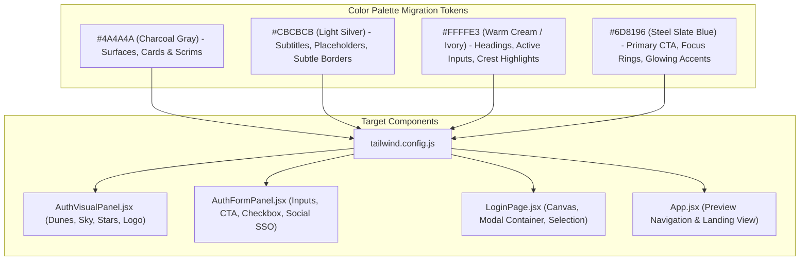

# Color Palette Migration Implementation Plan: Charcoal, Silver, Cream & Slate Blue

> **For agentic workers:** REQUIRED SUB-SKILL: Use superpowers:subagent-driven-development to implement this plan task-by-task. Steps use checkbox (`- [ ]`) syntax for tracking.

**Goal:** Migrate the Pusher frontend design tokens, split-screen authentication page (`LoginPage.jsx`), visual dune artwork (`AuthVisualPanel.jsx`), and interactive form panel (`AuthFormPanel.jsx`) to the newly provided 4-color palette (`#4A4A4A`, `#CBCBCB`, `#FFFFE3`, `#6D8196`).

**Architecture:** Update Tailwind configuration and component design tokens so that the dark charcoal surface (`#4A4A4A`), soft silver accents/borders (`#CBCBCB`), warm ivory typography (`#FFFFE3`), and steel slate blue CTA/accents (`#6D8196`) flow consistently across the UI without breaking accessibility or contrast.

**Architecture Diagram:**

**Tech Stack:**
- React 18
- Vite 5
- Tailwind CSS 3
- Lucide React

**Spec:** User reference image `media_1794842805838_a709e167.png` containing exact swatches:
1. `#4A4A4A` (Charcoal)
2. `#CBCBCB` (Silver Gray)
3. `#FFFFE3` (Warm Ivory / Cream)
4. `#6D8196` (Steel Slate Blue)

---

## Global Constraints

- **Strict Palette Adherence:** All backgrounds, typography, borders, buttons, and vector art must align exclusively with the 4 specified colors and their natural tonal gradients.
- **Git Safety Rule:** AI is strictly prohibited from executing `git commit`, `git merge`, `git rebase`, or `git push`.
- **Zero External Graphic Dependencies:** The dune landscape and brand marks remain self-contained SVG vectors.
- **Review Gate:** No code modification will occur until the user reviews and explicitly approves this plan.

---

## Proposed Token Mapping

| UI Element | Palette Token | Role & Visual Expression |
| :--- | :--- | :--- |
| **Page Canvas** | `#1C1F22` / `#23272B` | Deep nocturnal charcoal background derived from `#4A4A4A` |
| **Modal Container** | `#4A4A4A` / `#363B40` | Charcoal card surface with `#CBCBCB`/30 border and deep shadow |
| **Form Surface** | `#2B2F34` to `#353A40` | Refined dark charcoal container for high readability |
| **Input Fields** | `#1E2226` surface | Border in `#6D8196`/40, focus border `#6D8196`, placeholder in `#CBCBCB` |
| **Primary CTA Button** | `#6D8196` | Hover `#7D93AA`, active `#5B6E82` with `#FFFFE3` text |
| **Headings & Logo** | `#FFFFE3` | Crisp warm cream ivory typography for premium readability |
| **Subtitles & Labels** | `#CBCBCB` | Soft silver gray with high contrast against charcoal |
| **Visual Dune Art** | `#6D8196` & `#4A4A4A` | Slate blue twilight sky, charcoal dune shadows, and `#FFFFE3` crest stars |
| **Social SSO Buttons** | `#1E2226` / `#353A40` | Border `#CBCBCB`/40, hover border `#FFFFE3`, text `#FFFFE3` |

---

## Task Structure

### Task 1: Update Tailwind Config & Design Tokens

**Files:**
- Modify: `frontend/tailwind.config.js`
- Modify: `frontend/src/index.css`

**Interfaces:**
- Consumes: Palette swatches `#4A4A4A`, `#CBCBCB`, `#FFFFE3`, `#6D8196`
- Produces: Tailwind color tokens `pusher.charcoal`, `pusher.silver`, `pusher.cream`, `pusher.slate`

- [x] **Step 1:** Update `tailwind.config.js` to register the new 4-color palette tokens.
- [x] **Step 2:** Update `src/index.css` selection color and custom scrollbars to use `#6D8196` and `#4A4A4A`.

---

### Task 2: Restyle the Visual Dune Scenery Panel (`AuthVisualPanel.jsx`)

**Files:**
- Modify: `frontend/src/components/auth/AuthVisualPanel.jsx`

**Interfaces:**
- Consumes: Palette tokens
- Produces: Slate-and-Charcoal desert mountain dunes under starry twilight

- [x] **Step 1:** Update sky gradient from deep slate `#27323D` down to `#1B2026`.
- [x] **Step 2:** Restyle dune SVG gradients:
  - `duneBack`: `#3B4652` to `#222930`
  - `duneLitFace`: `#5B6E82` to `#42505E`
  - `duneShadowFace`: `#2E353D` to `#181B1F`
  - `duneFront`: `#36404A` to `#1D2227`
  - Crest highlight line: `#CBCBCB` with 0.8 opacity
- [x] **Step 3:** Update stars and horizon glow to warm ivory `#FFFFE3` and steel blue `#6D8196`.
- [x] **Step 4:** Brand mark: `"PU"` in `#FFFFE3` (warm cream) and `"SHER"` in `#6D8196` (slate blue).
- [x] **Step 5:** Slogan in `#FFFFE3` and active pagination pill in `#FFFFE3` with inactive dots in `#CBCBCB`/40.

---

### Task 3: Restyle the Authentication Form Panel (`AuthFormPanel.jsx`)

**Files:**
- Modify: `frontend/src/components/auth/AuthFormPanel.jsx`

**Interfaces:**
- Consumes: Palette tokens
- Produces: High-contrast, warm cream and steel blue interactive form

- [x] **Step 1:** Header title in `#FFFFE3`, subtitle in `#CBCBCB`, toggle link in `#FFFFE3` with hover `#6D8196`.
- [x] **Step 2:** Input backgrounds set to `#1E2226` with border `#6D8196`/40, text in `#FFFFE3`, and placeholder in `#CBCBCB`.
- [x] **Step 3:** Eye reveal icon in `#CBCBCB` with hover in `#FFFFE3`.
- [x] **Step 4:** Terms checkbox checked in `#6D8196` with `#FFFFE3` checkmark, link in `#FFFFE3`.
- [x] **Step 5:** Primary CTA button (`Create account` / `Log in`) styled in `#6D8196` (hover `#7D93AA`) with bold `#FFFFE3` text.
- [x] **Step 6:** Divider rule in `#CBCBCB`/30 with text in `#CBCBCB`.
- [x] **Step 7:** Social SSO buttons (Google, Apple, GitHub) styled with `#1E2226` surface, `#CBCBCB`/40 border, hover `#FFFFE3`, and `#FFFFE3` text.

---

### Task 4: Update `LoginPage.jsx` & Verify Build

**Files:**
- Modify: `frontend/src/pages/LoginPage.jsx`
- Modify: `frontend/src/App.jsx`

**Interfaces:**
- Consumes: All updated components
- Produces: Integrated authentication page in the new 4-color palette

- [x] **Step 1:** Set page canvas to `#202428`, toast notification to `#6D8196`, and modal container to `#2D3238` / `#4A4A4A` border `#CBCBCB`/30.
- [x] **Step 2:** Align `App.jsx` website preview header and buttons with the new palette.
- [x] **Step 3:** Run `npm run build` in `frontend/` to verify zero compile or styling errors.
- [x] **Step 4:** Update `walkthrough.md` with the new design token table and verification evidence.
