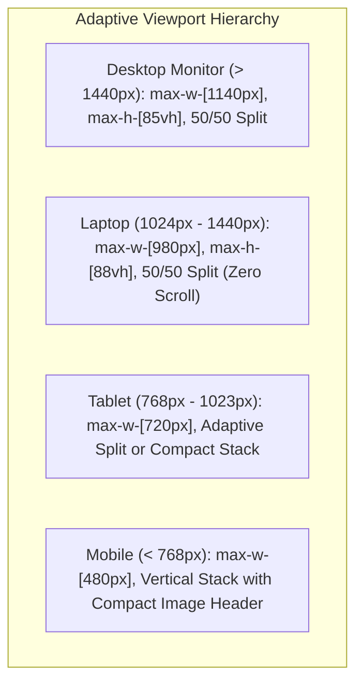

# Adaptive Responsive Scaling Implementation Plan (`LoginPage.jsx` & `AuthFormPanel.jsx`)

## 🎯 Goal Description
Fix the oversized authentication card issue and establish fluid, adaptive responsive scaling across all device types:
- **Mobile Phones** (< 640px)
- **Tablets** (640px – 1023px)
- **Laptops & Scaled Screens** (1024px – 1440px, 1366×768, 1080p @ 125%/150%)
- **Desktop Monitors** (> 1440px)

---

## 🔍 Phase 1: Root Cause Investigation (Systematic Debugging)

### Why Did the Login Page Size Increase This Much?
1. **Hardcoded Fixed Over-Sized Height in `LoginPage.jsx`**:
   - `min-h-[820px] lg:min-h-[880px]` and inner `min-h-[500px] lg:min-h-[860px]`.
   - On typical laptop viewports (e.g. 1920×1080 with 125% Windows scaling, or 1366×768 native), the effective browser viewport height is **~650px – 740px**. A fixed `880px` height forced the card to overflow vertically by ~150px–230px, generating ugly vertical scrollbars and pushing the bottom buttons out of sight.
2. **Excessive Container Width**:
   - `max-w-[1560px]` was hardcoded for the container, expanding the card across nearly the entire monitor width.
3. **Overstretched Form Elements in `AuthFormPanel.jsx`**:
   - The form container was set to `max-w-[620px]` with oversized horizontal paddings (`xl:px-18`), forcing input fields to stretch unnaturally wide (~500px+), and vertical padding (`py-4` per input and `py-4` on CTA button) made the form taller than standard laptop viewports.

---

## 📐 Responsive Architectural Design



### Proportional Scale Specs

| Viewport Category | Container Max Width | Container Max Height | Form Max Width | Split Layout | Scroll Required |
| :--- | :--- | :--- | :--- | :--- | :--- |
| **Large Monitor (>1440px)** | `1140px` | `800px` (`82vh`) | `420px` | 50% Left / 50% Right | **No** (Centered in screen) |
| **Laptop (1024px - 1440px)** | `980px` | `680px` (`88vh`) | `400px` | 50% Left / 50% Right | **No** (Fits full viewport) |
| **Tablet Landscape (800px - 1023px)** | `860px` | `620px` (`90vh`) | `380px` | 45% Left / 55% Right | **No** (Fits full viewport) |
| **Tablet Portrait / Mobile (<800px)** | `100%` (`max-w-[460px]`) | `auto` | `100%` | Single Column | Natural mobile scroll if needed |

---

## 📁 Proposed Changes

### Component 1: `frontend/src/pages/LoginPage.jsx`
#### [MODIFY] `frontend/src/pages/LoginPage.jsx`
- Replace hardcoded `max-w-[1560px] min-h-[820px] lg:min-h-[880px]` with responsive container:
  - `w-full max-w-[980px] xl:max-w-[1100px] 2xl:max-w-[1180px]`
  - `h-auto lg:h-[min(700px,88vh)]`
  - Rounded corners adjusted to `rounded-[28px]` for a sleek, balanced modern card look.
- Left image column:
  - `h-full min-h-[220px] lg:min-h-0`
  - Inner image wrapper: `h-full w-full rounded-[20px] overflow-hidden`
  - Maintains the dynamic 100-frame time-based landscape image with smooth atmospheric overlay.
- Keep the verified **Earthy Olive, Sage & Cream** color palette (`#EBEBD8` canvas, `#9BA685` card, `#455230` CTAs).

---

### Component 2: `frontend/src/components/auth/AuthFormPanel.jsx`
#### [MODIFY] `frontend/src/components/auth/AuthFormPanel.jsx`
- Form container max width adjusted to ergonomic standard:
  - `max-w-[420px] mx-auto px-6 py-6 sm:px-8 sm:py-7 lg:px-9 lg:py-6`
- Typography scaling:
  - Heading: `text-2xl sm:text-[28px] lg:text-[32px] font-black`
  - Segmented control: `mb-5 py-2 text-sm sm:text-base`
- Input field heights & spacing:
  - Spacing: `space-y-3 sm:space-y-3.5`
  - Inputs: `py-2.5 sm:py-3 px-3.5 text-sm sm:text-base rounded-xl`
  - Password toggle icon positioned neatly.
- Buttons & Socials:
  - CTA button: `py-3 sm:py-3.5 text-sm sm:text-base font-black rounded-xl mt-3`
  - Divider: `my-4 sm:my-5`
  - Social buttons: `py-2.5 px-3 text-xs sm:text-sm rounded-xl`

---

## 🧪 Verification Plan

### Automated Tests
```bash
cd frontend; npm run build
node "supporting files/testing/unit/test_time_mapping.cjs"
py -m pytest "supporting files/testing/unit/test_backend_auth.py" -v
```

### Browser Multi-Viewport Verification
Using the `browser` subagent:
1. **Laptop Viewport (1366 × 768 & 1280 × 800)**: Verify the full card fits on screen without vertical page scrollbar.
2. **Standard Desktop (1920 × 1080)**: Verify balanced, elegant centering with comfortable padding.
3. **Tablet Viewport (768 × 1024)**: Verify clean responsive adaptation.
4. **Mobile Viewport (390 × 844)**: Verify clean vertical layout.
5. Capture screenshots across multiple breakpoints.
