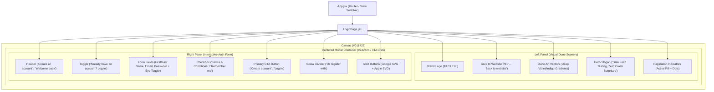

# Split-Screen Login & Authentication Page Implementation Plan

> **For agentic workers:** REQUIRED SUB-SKILL: Use superpowers:subagent-driven-development to implement this plan task-by-task. Steps use checkbox (`- [ ]`) syntax for tracking.

**Goal:** Build a pixel-accurate, responsive, dark-mode split-screen authentication component (`src/pages/LoginPage.jsx`) for **PUSHER** inside a clean Vite + React + Tailwind CSS setup, matching the exact visual aesthetics, color palette, dune artwork, typography, and controls of the reference design.

**Architecture:** A responsive 2-column modal container (`grid grid-cols-1 lg:grid-cols-12`) rendered on a deep canvas (`#011425`). The left panel (`lg:col-span-5` or `6`) renders custom dark-violet desert dune scenery, brand mark, glassmorphic "Back to website" pill, hero copy, and carousel indicators. The right panel (`lg:col-span-7` or `6`) hosts an interactive auth form supporting both **Sign Up** and **Log In** modes, custom styled inputs, password reveal toggle, terms agreement checkbox, primary accent action button, divider, and Google/Apple SSO buttons.

**Architecture Diagram:**

**Tech Stack:** 
- React 18
- Vite 5
- Tailwind CSS 3
- Lucide React (eye icons, arrow icons)
- Native SVG Vector Art (zero external broken image dependencies)

**Spec:** [User Reference UI Image: Split-Screen Auth Modal with Dunes Landscape & Official 5-Color Palette]

## Global Constraints

- **Strict Color Tokens:**
  - Page Canvas: `#011425`
  - Modal Card Surface: `#1A1F26` / `#242424` with `border-[#5C7C89]/30`
  - Input & Card Backgrounds: `#0D161C` / `#16222A` with `border-[#5C7C89]/40`
  - Primary Accent / CTA Button: `#7C5CFC` (violet-indigo matching reference image) with subtle `#1F4959` secondary cues
  - Typography: `#FFFFFF` (headings & values) and `#5C7C89` (placeholders, secondary labels)
- **Zero External Graphic Dependencies:** Dune landscape, Google icon, and Apple icon must be self-contained SVGs / CSS gradients to guarantee instant, offline-capable, and pixel-crisp rendering without CORS or broken URLs.
- **Git Safety Rule:** AI assistant is strictly prohibited from executing `git commit`, `git merge`, `git rebase`, or `git push`.
- **Testing Rule:** All test mocks and test scripts must live exclusively in `supporting files/testing/`.

---

## Task Structure

### Task 1: Initialize Clean Frontend Scaffolding

**Files:**
- Create: `frontend/package.json`
- Create: `frontend/vite.config.js`
- Create: `frontend/tailwind.config.js`
- Create: `frontend/postcss.config.js`
- Create: `frontend/index.html`
- Create: `frontend/src/index.css`

**Interfaces:**
- Consumes: Node.js 18+ runtime
- Produces: Working React + Vite + Tailwind CSS bundle

- [x] **Step 1: Write `package.json`** with React 18, Vite 5, Tailwind CSS 3, PostCSS, Autoprefixer, and Lucide React.
- [x] **Step 2: Write `vite.config.js`** with `@vitejs/plugin-react` and standard root resolution.
- [x] **Step 3: Write `tailwind.config.js`** with custom project colors (`canvas: #011425`, `surface: #242424`, `borderMuted: #5C7C89`, `brandTeal: #1F4959`, `accentViolet: #7C5CFC`).
- [x] **Step 4: Write `postcss.config.js`** configuring `tailwindcss` and `autoprefixer`.
- [x] **Step 5: Write `index.html`** configured with title `"PUSHER - Safe Load Testing"` and dark theme meta tags.
- [x] **Step 6: Write `src/index.css`** importing `@tailwind base;`, `@tailwind components;`, `@tailwind utilities;`, and custom scrollbar styles.
- [x] **Step 7: Run `npm install`** in `frontend/` to establish `node_modules` and verify clean dependency resolution.

---

### Task 2: Build the Visual Dune Scenery Panel (`AuthVisualPanel.jsx`)

**Files:**
- Create: `frontend/src/components/auth/AuthVisualPanel.jsx`

**Interfaces:**
- Consumes: Props `onBackToWebsite: () => void`, `slogan?: string`
- Produces: Self-contained visual artwork panel with PUSHER logo, glassmorphic pill button, layered night dunes, atmospheric lighting, and carousel dots

- [x] **Step 1: Build Layered SVG Dune Artwork**:
  - Deep moody purple/indigo gradients (`#2D1B69` down to `#09041A` and `#140A2B`).
  - Layered smooth bezier curves representing sand dunes with subtle rim highlights and soft shadow gradients.
  - Atmospheric star/celestial glow elements simulating a night sky.
- [x] **Step 2: Add Top Brand & Navigation Header**:
  - Upper-left: Stylized `"PUSHER"` brand mark in bold crisp white (`font-bold tracking-wider text-xl`).
  - Streamlined top bar with clean brand alignment.
- [x] **Step 3: Add Bottom Slogan & Carousel Pagination Indicators**:
  - Slogan headline: `"Safe Load Testing, Zero Crash Surprises"` in bold white with balanced leading.
  - Carousel indicators: 3 horizontal indicators (first dot, active elongated pill `w-6 h-1.5 bg-white rounded-full`, third dot).

---

### Task 3: Build the Interactive Auth Form Panel (`AuthFormPanel.jsx`)

**Files:**
- Create: `frontend/src/components/auth/AuthFormPanel.jsx`

**Interfaces:**
- Consumes: Props `mode: 'signup' | 'login'`, `onToggleMode: () => void`, `onSubmit: (data) => void`
- Produces: Pixel-perfect form controls matching the reference UI, with full keyboard accessibility and error/state feedback

- [x] **Step 1: Header & Mode Toggle**:
  - Heading: `"Create an account"` (or `"Welcome back"`).
  - Subtitle: `"Already have an account? "` with interactive clickable text `"Log in"` (or `"Don't have an account? Sign up"`).
- [x] **Step 2: Form Inputs & Password Toggle**:
  - In Sign Up mode: Side-by-side First name and Last name inputs (`grid grid-cols-2 gap-3`).
  - Email input with placeholder `"Email"`.
  - Password input with placeholder `"Enter your password"` and an interactive Lucide `Eye` / `EyeOff` button inside the right padding.
  - Consistent styling: `bg-[#131A22] border border-[#5C7C89]/40 focus:border-[#7C5CFC] focus:ring-1 focus:ring-[#7C5CFC] text-white placeholder-[#5C7C89] rounded-lg px-3.5 py-2.5 text-sm outline-none transition-all`.
- [x] **Step 3: Terms Checkbox / Remember Me**:
  - Custom styled checkbox with checkmark: `"I agree to the "` + link `"Terms & Conditions"`.
  - In login mode: `"Remember me"` checkbox alongside `"Forgot password?"` link.
- [x] **Step 4: Primary CTA Button**:
  - Full-width button with rich purple gradient/solid (`bg-[#6E56CF] hover:bg-[#7C5CFC] active:scale-[0.99] text-white font-medium py-2.5 rounded-lg shadow-lg shadow-[#6E56CF]/25 transition-all`).
  - Button text: `"Create account"` / `"Log in"`.
- [x] **Step 5: Social Authentication Divider & SSO Buttons**:
  - Divider: Centered text `"Or register with"` (or `"Or log in with"`) flanked by subtle horizontal lines (`border-t border-[#5C7C89]/20`).
  - Google Button: White surface/dark border with official Google 4-color SVG icon and label `"Google"`.
  - Apple Button: Dark surface/border with official Apple logo SVG icon and label `"Apple"`.

---

### Task 4: Assemble `LoginPage.jsx` & Connect to `App.jsx`

**Files:**
- Create: `frontend/src/pages/LoginPage.jsx`
- Create: `frontend/src/App.jsx`
- Create: `frontend/src/main.jsx`

**Interfaces:**
- Consumes: `AuthVisualPanel` and `AuthFormPanel`
- Produces: Full split-screen modal view responsive from mobile (`< 1024px` single stacked column) to desktop (`>= 1024px` 2-column side-by-side card)

- [x] **Step 1: Create `src/pages/LoginPage.jsx`**:
  - Center the modal inside a full-height canvas (`min-h-screen bg-[#011425] flex items-center justify-center p-4 sm:p-6 lg:p-8`).
  - Wrap components in an outer card (`w-full max-w-4xl bg-[#1A1F26] border border-[#5C7C89]/30 rounded-2xl shadow-2xl overflow-hidden grid grid-cols-1 lg:grid-cols-12 min-h-[580px]`).
  - Connect state between form submissions, mode changes, and navigation events.
- [x] **Step 2: Connect `src/App.jsx` and `src/main.jsx`**:
  - Set up view state to seamlessly render `LoginPage` with mock navigation back to a landing/dashboard view.
- [x] **Step 3: Run Production Build**:
  - Execute `npm run build` in `frontend/` to confirm zero lint or TypeScript/JSX compile errors.
- [x] **Step 4: Verification & Walkthrough**:
  - Verify layout responsiveness, color contrast, and interactive states.
  - Document all commands for the user to run the app (`npm run dev`).
